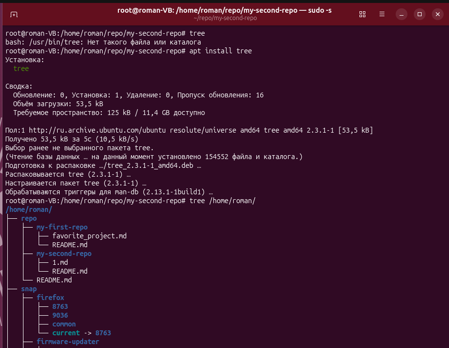
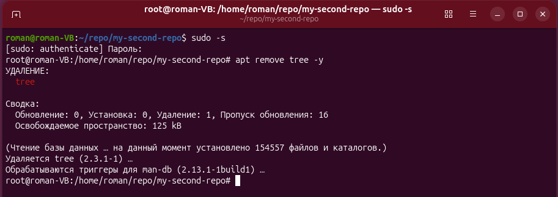
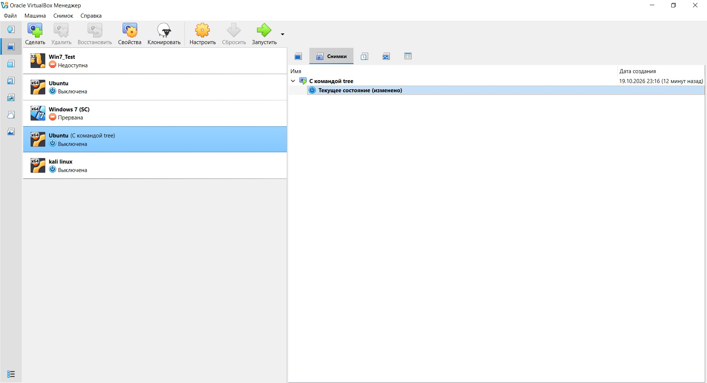
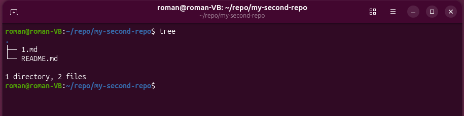

# Листинги команд для работы с файлами в Linux

## Листинг команды touch
```bash
root@roman-VB:/home/roman/repo/my-second-repo# touch --help

Usage: touch [OPTION]... [FILE]...

Arguments:
  [files]...  

Options:
      --help              Print help information.
  -a                      change only the access time
  -t <STAMP>              use [[CC]YY]MMDDhhmm[.ss] instead of the current time
  -d, --date <STRING>     parse argument and use it instead of current time
  -f                      (ignored)
  -m                      change only the modification time
  -c, --no-create         do not create any files
  -h, --no-dereference    affect each symbolic link instead of any referenced
                          file (only for systems that can change the timestamps
                          of a symlink)
  -r, --reference <FILE>  use this file's times instead of the current time
      --time <WORD>       change only the specified time: "access", "atime", or
                          "use" are equivalent to -a; "modify" or "mtime" are
                          equivalent to -m [possible values: atime, mtime]
  -V, --version           Print version
```

## Листинг команды cat
```bash
root@roman-VB:/home/roman/repo/my-second-repo# cat --help
Concatenate FILE(s), or standard input, to standard output
With no FILE, or when FILE is -, read standard input.

Usage: cat [OPTION]... [FILE]...

Options:
  -A, --show-all          equivalent to -vET
  -b, --number-nonblank   number nonempty output lines, overrides -n
  -e                      equivalent to -vE
  -E, --show-ends         display $ at end of each line
  -n, --number            number all output lines
  -s, --squeeze-blank     suppress repeated empty output lines
  -t                      equivalent to -vT
  -T, --show-tabs         display TAB characters at ^I
  -v, --show-nonprinting  use ^ and M- notation, except for LF (\n) and TAB (\t)
  -u                      (ignored)
  -h, --help              Print help
  -V, --version           Print version
```

## Листинг команды nano
```bash
root@roman-VB:/home/roman/repo/my-second-repo# nano --help
Использование: nano [ОПЦИИ] [[+СТРОКА[,СТОЛБЕЦ]] ФАЙЛ]…

Чтобы поместить курсор на определённую строку файла, введите номер
и «+» перед именем файла. Номер столбца можно ввести после запятой.
Когда задано имя файла «-», то nano читает данные со стандартного ввода.

 Опция          Длинная опция           Значение
 -A             --smarthome             Включить умную кнопку home
 -B             --backup                Сохранять резервные копии существующих файлов
 -C <каталог>   --backupdir=<каталог>   Каталог для хранения уникальных резервных копий
 -D             --boldtext              Использовать жирный шрифт
 -E             --tabstospaces          Преобразовать табуляции в пробелы
 -F             --multibuffer           По умолчанию читать файл в новый буфер
 -G             --locking               Использовать файлы блокировки (как в vim)
 -H             --historylog            Сохранить и загрузить старые строки поиска/замены
 -I             --ignorercfiles         Не использовать на файлы nanorc
 -J <число>     --guidestripe=<число>   Показать линейку на этом столбце
 -K             --rawsequences          Исправлять проблему малой клавиатуры
 -L             --nonewlines            Не добавлять пустую строку в конце
 -M             --trimblanks            Обрезать хвостовые пробелы при ручном переносе строк
 -N             --noconvert             Не преобразовывать из DOS/Mac формата
 -O             --bookstyle             Ведущий пробел означает новый параграф
 -P             --positionlog           Сохранить и восстановить расположение курсора
 -Q <regex>     --quotestr=<regex>      Регулярное выражение для поиска кавычек
 -R             --restricted            Ограничить доступ к файловой система
 -S             --softwrap              Переносить длинные строки при просмотре
 -T <число>     --tabsize=<число>       Установить ширину табуляции
 -U             --quickblank            Очищать строку состояние при нажатии
 -V             --version               Показать версию и выйти
 -W             --wordbounds            Использовать более точное определение границ слов
 -X <строка>    --wordchars=<строка>    Какие еще символы являются частью слова
 -Y <имя>       --syntax=<имя>          Использовать описание синтаксиса для подсветки
 -Z             --zap                   Очищать выделенную область с помощью Bsp и Del
 -a             --atblanks              Делать мягкий перенос только на пробелах
 -b             --breaklonglines        Жестко переносить слишком длинные строки
 -c             --constantshow          Постоянно показывать позицию курсора
 -d             --rebinddelete          Исправить проблему Backspace/Delete
 -e             --emptyline             Не занимать строку под строкой заголовком
 -f <файл>      --rcfile=<файл>         Использовать только этот файл для настроек nano
 -g             --showcursor            Показывать курсор и текст справки в файловом менеджере
 -h             --help                  Показать этот текст и выйти
 -i             --autoindent            Автоматический отступ на новых строках
 -j             --jumpyscrolling        Прокрутка по пол-экрана, а не по строке
 -k             --cutfromcursor         Вырезать от курсора до конца строки
 -l             --linenumbers           Показывать номера строк перед текстом
 -m             --mouse                 Разрешить использование мыши
 -n             --noread                Не читать файл (только писать его)
 -o <каталог>   --operatingdir=<каталог>Установить рабочий каталог
 -p             --preserve              Зарезервировать кнопки XON (^Q) и XOFF (^S)
 -q             --indicator             Показать индикатор позиции+части
 -r <число>     --fill=<число>          Установить ширину для жесткого переноса и выравнивания
 -s <программа> --speller=<программа>   Использовать эту альтернативную проверку правописания
 -t             --saveonexit            Не спрашивая сохранять изменения при выходе
 -u             --unix                  По умолчанию сохранять файл в Unix формате
 -v             --view                  Режим просмотра (только чтение)
 -w             --nowrap                Не переносить длинные строки [по умолчанию]
 -x             --nohelp                Не показывать две строки помощи внизу
 -y             --afterends             Останавливаться на краях слов при зажатом Ctrl+Right
 -z             --listsyntaxes          Показать список доступных синтаксисов
 -@             --colonparsing          Принять нотацию 'имяфайла:номерстроки'
 -%             --stateflags            Показывать состояния в строке заголовка
 -_             --minibar               Показать панель обратной связи внизу
 -0             --zero                  Скрыть все панели и развернуть терминал
 -/             --modernbindings        Использовать известные сочетания клавиш
```

## Листинг команды pwd
```bash
root@roman-VB:/home/roman/repo/my-second-repo# pwd --help
pwd: pwd [-LP]
    Print the name of the current working directory.
    
    Options:
      -L	print the value of $PWD if it names the current working
    		directory
      -P	print the physical directory, without any symbolic links
    
    By default, `pwd' behaves as if `-L' were specified.
    
    Exit Status:
    Returns 0 unless an invalid option is given or the current directory
    cannot be read.
```

## Листинг команды ls
```bash
root@roman-VB:/home/roman/repo/my-second-repo# ls --help
List directory contents.
Ignore files and directories starting with a '.' by default

Usage: ls [OPTION]... [FILE]...

Options:
      --help
          Print help information.
      --format <format>
          Set the display format.
  -C
          Display the files in columns.
  -l, --long
          Display detailed information.
  -x
          List entries in rows instead of in columns.
  -T, --tabsize <COLS>
          Assume tab stops at each COLS instead of 8 [env: TABSIZE=]
  -m
          List entries separated by commas.
      --zero
          List entries separated by ASCII NUL characters.
  -D, --dired
          generate output designed for Emacs' dired (Directory Editor) mode
      --hyperlink[=<WHEN>]
          hyperlink file names WHEN [default: never] [possible values: always, auto, never]
  -1
          List one file per line.
  -o
          Long format without group information.
          Identical to --format=long with --no-group.
  -g
          Long format without owner information.
  -n, --numeric-uid-gid
          -l with numeric UIDs and GIDs.
      --quoting-style <quoting-style>
          Set quoting style. [possible values: literal, locale, shell, shell-escape, shell-always,
          shell-escape-always, clocale, c, escape]
  -N, --literal
          Use literal quoting style. Equivalent to `--quoting-style=literal`
  -b, --escape
          Use escape quoting style. Equivalent to `--quoting-style=escape`
  -Q, --quote-name
          Use C quoting style. Equivalent to `--quoting-style=c`
  -q, --hide-control-chars
          Replace control characters with '?' if they are not escaped.
      --show-control-chars
          Show control characters 'as is' if they are not escaped.
      --time <field>
          Show time in `<field>`:
          access time (-u): atime, access, use;
          change time (-t): ctime, status.
          modification time: mtime, modification.
          birth time: birth, creation;
  -c
          If the long listing format (e.g., -l, -o) is being used, print the
          status change time (the 'ctime' in the inode) instead of the modification
          time. When explicitly sorting by time (--sort=time or -t) or when not
          using a long listing format, sort according to the status change time.
  -u
          If the long listing format (e.g., -l, -o) is being used, print the
          status access time instead of the modification time. When explicitly
          sorting by time (--sort=time or -t) or when not using a long listing
          format, sort according to the access time.
      --hide <PATTERN>
          do not list implied entries matching shell PATTERN (overridden by -a or -A)
  -I, --ignore <PATTERN>
          do not list implied entries matching shell PATTERN
  -B, --ignore-backups
          Ignore entries which end with ~.
      --sort <field>
          Sort by `<field>`: name, none (-U), time (-t), size (-S), extension (-X) or width [possible values:
          name, none, time, size, version, extension, width]
  -S
          Sort by file size, largest first.
  -t
          Sort by modification time (the 'mtime' in the inode), newest first.
  -v
          Natural sort of (version) numbers in the filenames.
  -X
          Sort alphabetically by entry extension.
  -U
          Do not sort; list the files in whatever order they are stored in the
          directory.  This is especially useful when listing very large directories,
          since not doing any sorting can be noticeably faster.
  -L, --dereference
          When showing file information for a symbolic link, show information for the
          file the link references rather than the link itself.
      --dereference-command-line-symlink-to-dir
          Do not follow symlinks except when they link to directories and are
          given as command line arguments.
  -H, --dereference-command-line
          Do not follow symlinks except when given as command line arguments.
  -G, --no-group
          Do not show group in long format.
      --author
          Show author in long format. On the supported platforms,
          the author always matches the file owner.
  -a, --all
          Do not ignore hidden files (files with names that start with '.').
  -A, --almost-all
          In a directory, do not ignore all file names that start with '.',
          only ignore '.' and '..'.
  -f
          List all files in directory order, unsorted. Equivalent to -aU. Disables --color unless explicitly
          specified.
  -d, --directory
          Only list the names of directories, rather than listing directory contents.
          This will not follow symbolic links unless one of `--dereference-command-line
          (-H)`, `--dereference (-L)`, or `--dereference-command-line-symlink-to-dir` is
          specified.
  -h, --human-readable
          Print human readable file sizes (e.g. 1K 234M 56G).
  -k, --kibibytes
          default to 1024-byte blocks for file system usage; used only with -s and per
          directory totals
      --si
          Print human readable file sizes using powers of 1000 instead of 1024.
      --block-size <BLOCK_SIZE>
          scale sizes by BLOCK_SIZE when printing them
  -i, --inode
          print the index number of each file
  -r, --reverse
          Reverse whatever the sorting method is e.g., list files in reverse
          alphabetical order, youngest first, smallest first, or whatever.
  -R, --recursive
          List the contents of all directories recursively.
  -w, --width <COLS>
          Assume that the terminal is COLS columns wide.
  -s, --size
          print the allocated size of each file, in blocks
      --color[=<color>]
          Color output based on file type. [possible values: always, auto, never]
      --indicator-style <indicator-style>
          Append indicator with style WORD to entry names:
          none (default),  slash (-p), file-type (--file-type), classify (-F) [possible values: none, slash,
          file-type, classify]
  -F, --classify[=<when>]
          Append a character to each file name indicating the file type. Also, for
          regular files that are executable, append '*'. The file type indicators are
          '/' for directories, '@' for symbolic links, '|' for FIFOs, '=' for sockets,
          '>' for doors, and nothing for regular files. when may be omitted, or one of:
              none - Do not classify. This is the default.
              auto - Only classify if standard output is a terminal.
              always - Always classify.
          Specifying --classify and no when is equivalent to --classify=always. This will
          not follow symbolic links listed on the command line unless the
          --dereference-command-line (-H), --dereference (-L), or
          --dereference-command-line-symlink-to-dir options are specified. [possible values: always, auto, never]
      --file-type
          Same as --classify, but do not append '*'
  -p
          Append / indicator to directories.
      --time-style <TIME_STYLE>
          time/date format with -l; see TIME_STYLE below [env: TIME_STYLE=]
      --full-time
          like -l --time-style=full-iso
  -Z, --context
          print any security context of each file
      --group-directories-first
          group directories before files; can be augmented with
          a --sort option, but any use of --sort=none (-U) disables grouping
  -V, --version
          Print version
```

## Листинг команды head
```bash
root@roman-VB:/home/roman/repo/my-second-repo# head --help
Print the first 10 lines of each FILE to standard output.
With more than one FILE, precede each with a header giving the file name.
With no FILE, or when FILE is -, read standard input.

Mandatory arguments to long options are mandatory for short options too.

Usage: head [OPTION]... [FILE]...

Arguments:
  [FILE]...  [default: -]

Options:
  -c, --bytes <[-]NUM>   print the first NUM bytes of each file;
                         with a leading '-', print all but the last
                         NUM bytes of each file
  -n, --lines <[-]NUM>   print the first NUM lines instead of the first 10;
                         with a leading '-', print all but the last
                         NUM lines of each file
  -q, --quiet            never print headers giving file names [alias: --silent]
  -v, --verbose          always print headers giving file names
  -z, --zero-terminated  line delimiter is NUL, not newline
  -h, --help             Print help
  -V, --version          Print version
```

## Листинг команды tail
```bash
root@roman-VB:/home/roman/repo/my-second-repo# head --help
Print the first 10 lines of each FILE to standard output.
With more than one FILE, precede each with a header giving the file name.
With no FILE, or when FILE is -, read standard input.

Mandatory arguments to long options are mandatory for short options too.

Usage: head [OPTION]... [FILE]...

Arguments:
  [FILE]...  [default: -]

Options:
  -c, --bytes <[-]NUM>   print the first NUM bytes of each file;
                         with a leading '-', print all but the last
                         NUM bytes of each file
  -n, --lines <[-]NUM>   print the first NUM lines instead of the first 10;
                         with a leading '-', print all but the last
                         NUM lines of each file
  -q, --quiet            never print headers giving file names [alias: --silent]
  -v, --verbose          always print headers giving file names
  -z, --zero-terminated  line delimiter is NUL, not newline
  -h, --help             Print help
  -V, --version          Print version
```

## Листинг команды less
```bash
root@roman-VB:/home/roman/repo/my-second-repo# less README.md 
# Листинги команд для работы с файлами в Linux

## Листинг команды touch
```bash
root@roman-VB:/home/roman/repo/my-second-repo# touch --help

Usage: touch [OPTION]... [FILE]...

Arguments:
  [files]...  

Options:
      --help              Print help information.
  -a                      change only the access time
  -t <STAMP>              use [[CC]YY]MMDDhhmm[.ss] instead of the current time
  -d, --date <STRING>     parse argument and use it instead of current time
  -f                      (ignored)
  -m                      change only the modification time
  -c, --no-create         do not create any files
  -h, --no-dereference    affect each symbolic link instead of any referenced
                          file (only for systems that can change the timestamps
                          of a symlink)
  -r, --reference <FILE>  use this file's times instead of the current time
      --time <WORD>       change only the specified time: "access", "atime", or
                          "use" are equivalent to -a; "modify" or "mtime" are
                          equivalent to -m [possible values: atime, mtime]
  -V, --version           Print version
```

## Листинг команды cat
```bash
root@roman-VB:/home/roman/repo/my-second-repo# cat --help
Concatenate FILE(s), or standard input, to standard output
With no FILE, or when FILE is -, read standard input.

Usage: cat [OPTION]... [FILE]...

Options:
  -A, --show-all          equivalent to -vET
```
## Листинг команды tree
```bash
root@roman-VB:/home/roman/repo/my-second-repo# tree --help
usage: tree [-acdfghilnpqrstuvxACDFJQNSUX] [-L level [-R]] [-H [-]baseHREF]
	[-T title] [-o filename] [-P pattern] [-I pattern] [--gitignore]
	[--gitfile[=]file] [--matchdirs] [--metafirst] [--ignore-case]
	[--nolinks] [--hintro[=]file] [--houtro[=]file] [--inodes] [--device]
	[--sort[=]name] [--dirsfirst] [--filesfirst] [--filelimit[=]#] [--si]
	[--du] [--prune] [--charset[=]X] [--timefmt[=]format] [--fromfile]
	[--fromtabfile] [--fflinks] [--info] [--infofile[=]file] [--noreport]
	[--hyperlink] [--scheme[=]schema] [--authority[=]host] [--opt-toggle]
	[--compress[=]#] [--condense] [--version] [--help] [--acl] [--selinux]
	[--] [directory ...]
  ------- Listing options -------
  -a            All files are listed.
  -d            List directories only.
  -l            Follow symbolic links like directories.
  -f            Print the full path prefix for each file.
  -x            Stay on current filesystem only.
  -L level      Descend only level directories deep.
  -R            Rerun tree when max dir level reached.
  -P pattern    List only those files that match the pattern given.
  -I pattern    Do not list files that match the given pattern.
  --gitignore   Filter by using .gitignore files.
  --gitfile X   Explicitly read a gitignore file.
  --ignore-case Ignore case when pattern matching.
  --matchdirs   Include directory names in -P pattern matching.
  --metafirst   Print meta-data at the beginning of each line.
  --prune       Prune empty directories from the output.
  --info        Print information about files found in .info files.
  --infofile X  Explicitly read info file.
  --noreport    Turn off file/directory count at end of tree listing.
  --charset X   Use charset X for terminal/HTML and indentation line output.
  --filelimit # Do not descend dirs with more than # files in them.
  --condense    Condense directory singletons to a single line of output.
  -o filename   Output to file instead of stdout.
  ------- File options -------
  -q            Print non-printable characters as '?'.
  -N            Print non-printable characters as is.
  -Q            Quote filenames with double quotes.
  -p            Print the protections for each file.
  -u            Displays file owner or UID number.
  -g            Displays file group owner or GID number.
  -s            Print the size in bytes of each file.
  -h            Print the size in a more human readable way.
  --si          Like -h, but use in SI units (powers of 1000).
  --du          Compute size of directories by their contents.
  -D            Print the date of last modification or (-c) status change.
  --timefmt fmt Print and format time according to the format fmt.
  -F            Appends '/', '=', '*', '@', '|' or '>' as per ls -F.
  --inodes      Print inode number of each file.
  --device      Print device ID number to which each file belongs.
  --acl         Print permissions with a + if an ACL is present.
  --selinux     Print the selinux security label if present.
  ------- Sorting options -------
  -v            Sort files alphanumerically by version.
  -t            Sort files by last modification time.
  -c            Sort files by last status change time.
  -U            Leave files unsorted.
  -r            Reverse the order of the sort.
  --dirsfirst   List directories before files (-U disables).
  --filesfirst  List files before directories (-U disables).
  --sort X      Select sort: name,version,size,mtime,ctime,none.
  ------- Graphics options -------
  -i            Don't print indentation lines.
  -A            Print ANSI lines graphic indentation lines.
  -S            Print with CP437 (console) graphics indentation lines.
  -n            Turn colorization off always (-C overrides).
  -C            Turn colorization on always.
  --compress #  Compress indentation lines.
  ------- XML/HTML/JSON/HYPERLINK options -------
  -X            Prints out an XML representation of the tree.
  -J            Prints out an JSON representation of the tree.
  -H baseHREF   Prints out HTML format with baseHREF as top directory.
  -T string     Replace the default HTML title and H1 header with string.
  --nolinks     Turn off hyperlinks in HTML output.
  --hintro X    Use file X as the HTML intro.
  --houtro X    Use file X as the HTML outro.
  --hyperlink   Turn on OSC 8 terminal hyperlinks.
  --scheme X    Set OSC 8 hyperlink scheme, default file://
  --authority X Set OSC 8 hyperlink authority/hostname.
  ------- Input options -------
  --fromfile    Reads paths from files (.=stdin)
  --fromtabfile Reads trees from tab indented files (.=stdin)
  --fflinks     Process link information when using --fromfile.
  ------- Miscellaneous options -------
  --opt-toggle  Enable option toggling.
  --version     Print version and exit.
  --help        Print usage and this help message and exit.
  --            Options processing terminator.
```
## Листинг команды mkdir
```bash
root@roman-VB:/home/roman/repo/my-second-repo# tree --help
usage: tree [-acdfghilnpqrstuvxACDFJQNSUX] [-L level [-R]] [-H [-]baseHREF]
	[-T title] [-o filename] [-P pattern] [-I pattern] [--gitignore]
	[--gitfile[=]file] [--matchdirs] [--metafirst] [--ignore-case]
	[--nolinks] [--hintro[=]file] [--houtro[=]file] [--inodes] [--device]
	[--sort[=]name] [--dirsfirst] [--filesfirst] [--filelimit[=]#] [--si]
	[--du] [--prune] [--charset[=]X] [--timefmt[=]format] [--fromfile]
	[--fromtabfile] [--fflinks] [--info] [--infofile[=]file] [--noreport]
	[--hyperlink] [--scheme[=]schema] [--authority[=]host] [--opt-toggle]
	[--compress[=]#] [--condense] [--version] [--help] [--acl] [--selinux]
	[--] [directory ...]
  ------- Listing options -------
  -a            All files are listed.
  -d            List directories only.
  -l            Follow symbolic links like directories.
  -f            Print the full path prefix for each file.
  -x            Stay on current filesystem only.
  -L level      Descend only level directories deep.
  -R            Rerun tree when max dir level reached.
  -P pattern    List only those files that match the pattern given.
  -I pattern    Do not list files that match the given pattern.
  --gitignore   Filter by using .gitignore files.
  --gitfile X   Explicitly read a gitignore file.
  --ignore-case Ignore case when pattern matching.
  --matchdirs   Include directory names in -P pattern matching.
  --metafirst   Print meta-data at the beginning of each line.
  --prune       Prune empty directories from the output.
  --info        Print information about files found in .info files.
  --infofile X  Explicitly read info file.
  --noreport    Turn off file/directory count at end of tree listing.
  --charset X   Use charset X for terminal/HTML and indentation line output.
  --filelimit # Do not descend dirs with more than # files in them.
  --condense    Condense directory singletons to a single line of output.
  -o filename   Output to file instead of stdout.
  ------- File options -------
  -q            Print non-printable characters as '?'.
  -N            Print non-printable characters as is.
  -Q            Quote filenames with double quotes.
  -p            Print the protections for each file.
  -u            Displays file owner or UID number.
  -g            Displays file group owner or GID number.
  -s            Print the size in bytes of each file.
  -h            Print the size in a more human readable way.
  --si          Like -h, but use in SI units (powers of 1000).
  --du          Compute size of directories by their contents.
  -D            Print the date of last modification or (-c) status change.
  --timefmt fmt Print and format time according to the format fmt.
  -F            Appends '/', '=', '*', '@', '|' or '>' as per ls -F.
  --inodes      Print inode number of each file.
  --device      Print device ID number to which each file belongs.
  --acl         Print permissions with a + if an ACL is present.
  --selinux     Print the selinux security label if present.
  ------- Sorting options -------
  -v            Sort files alphanumerically by version.
  -t            Sort files by last modification time.
  -c            Sort files by last status change time.
  -U            Leave files unsorted.
  -r            Reverse the order of the sort.
  --dirsfirst   List directories before files (-U disables).
  --filesfirst  List files before directories (-U disables).
  --sort X      Select sort: name,version,size,mtime,ctime,none.
  ------- Graphics options -------
  -i            Don't print indentation lines.
  -A            Print ANSI lines graphic indentation lines.
  -S            Print with CP437 (console) graphics indentation lines.
  -n            Turn colorization off always (-C overrides).
  -C            Turn colorization on always.
  --compress #  Compress indentation lines.
  ------- XML/HTML/JSON/HYPERLINK options -------
  -X            Prints out an XML representation of the tree.
  -J            Prints out an JSON representation of the tree.
  -H baseHREF   Prints out HTML format with baseHREF as top directory.
  -T string     Replace the default HTML title and H1 header with string.
  --nolinks     Turn off hyperlinks in HTML output.
  --hintro X    Use file X as the HTML intro.
  --houtro X    Use file X as the HTML outro.
  --hyperlink   Turn on OSC 8 terminal hyperlinks.
  --scheme X    Set OSC 8 hyperlink scheme, default file://
  --authority X Set OSC 8 hyperlink authority/hostname.
  ------- Input options -------
  --fromfile    Reads paths from files (.=stdin)
  --fromtabfile Reads trees from tab indented files (.=stdin)
  --fflinks     Process link information when using --fromfile.
  ------- Miscellaneous options -------
  --opt-toggle  Enable option toggling.
  --version     Print version and exit.
  --help        Print usage and this help message and exit.
  --            Options processing terminator.
root@roman-VB:/home/roman/repo/my-second-repo# mkdir --help
Create the given DIRECTORY(ies) if they do not exist

Usage: mkdir [OPTION]... DIRECTORY...

Arguments:
  <dirs>...  

Options:
  -m, --mode <mode>    set file mode (not implemented on windows)
  -p, --parents        make parent directories as needed
  -v, --verbose        print a message for each printed directory
  -Z                   set SELinux security context of each created directory to the default type
      --context <CTX>  like -Z, or if CTX is specified then set the SELinux or SMACK security context to CTX
  -h, --help           Print help
  -V, --version        Print version

Each MODE is of the form [ugoa]*([-+=]([rwxXst]*|[ugo]))+|[-+=]?[0-7]+.
```

## Листинг команды rm
```bash
root@roman-VB:/home/roman/repo/my-second-repo# rm --help
Использование: rm [ПАРАМЕТР]… [ФАЙЛ]…
Удаляет (ссылки на) ФАЙЛ(ы).

  -f, --force         игнорировать несуществующие файлы и аргументы,
                      ни о чём не спрашивать
  -i                  запрашивать подтверждение перед каждым удалением
  -I                  запрашивать подтверждение один раз перед удалением
                      более трёх файлов или перед рекурсивным удалением;
                      не так назойливо, как с -i, но всё же защищает
                      от большинства ошибок
      --interactive[=КОГДА] запрашивать подтверждение в соответствии
                      с КОГДА: never (никогда), once (-I, один раз) или
                      always (-i, всегда);
                      если КОГДА не задано — запрашивать всегда
      --one-file-system  при рекурсивном удалении дерева, пропускать все
                      каталоги, находящиеся не на той же файловой системе,
                      что и соответствующий аргумент командной строки
      --no-preserve-root не обрабатывать «/» особым образом
      --preserve-root[=all] не удалять «/» (по умолчанию);
                      при указании «all» отвергать любой аргумент
                      командной строки на отдельном устройстве
                      от его родителя
  -r, -R, --recursive рекурсивно удалять каталоги и их содержимое
  -d, --dir           удалять пустые каталоги
  -v, --verbose       пояснять производимые действия
      --help     показать эту справку и выйти
      --version  показать информацию о версии и выйти

По умолчанию rm не удаляет каталоги. Используйте параметр --recursive (-r
или -R), чтобы удалить все перечисленные каталоги вместе с их
содержимым.

Any attempt to remove a file whose last file name component is '.' or '..'
is rejected with a diagnostic.

Для удаления файла, начинающегося с «-» (например: «-foo»),
используйте одну из следующих команд:
  rm -- -foo

  rm ./-foo

Если вы используете rm для удаления файла, будет возможно восстановить
часть его содержимого при наличии достаточного опыта и  времени.  Для большей
уверенности в том, что содержимое не подлежит восстановлению, используйте shred(1).

Страница справки по GNU coreutils: <https://www.gnu.org/software/coreutils/>
Об ошибках в переводе сообщений сообщайте по адресу <https://translationproject.org/team/ru.html>
Полная документация: <https://www.gnu.org/software/coreutils/rm>
или доступная локально: info '(coreutils) rm invocation
```

## Листинг команды rmdir
```bash
root@roman-VB:/home/roman/repo/my-second-repo# rmdir --help
Remove the DIRECTORY(ies), if they are empty.

Usage: rmdir [OPTION]... DIRECTORY...

Arguments:
  <dirs>...  

Options:
      --ignore-fail-on-non-empty  ignore each failure that is solely because a directory is non-empty
  -p, --parents                   remove DIRECTORY and its ancestors; e.g., 'rmdir -p a/b/c' is similar to rmdir
                                  a/b/c a/b a
  -v, --verbose                   output a diagnostic for every directory processed
  -h, --help                      Print help
  -V, --version                   Print version
```

# Скриншоты установки, удаления утилиты tree и восстановления из "слепка" виртуальной машины 

|  |
|:---:|
| *Рис. 1 Установка утилиты tree* |

|  |
|:---:|
| *Рис. 2 Удаление утилиты tree* |

|  |
|:---:|
| *Рис. 3 Восстановление из снимка виртуальной машины* |

|  |
|:---:|
| *Рис. 4 Восстановление работы утилиты tree* |

# Листинг выполнения команды visudo

```bash
root@roman-VB:/home/roman/repo/my-second-repo# visudo -f /etc/sudoers.d/roman-nopasswd
root@roman-VB:/home/roman/repo/my-second-repo# cat /etc/sudoers.d/roman-nopasswd 
roman ALL=(ALL:ALL) NOPASSWD:ALL
```
